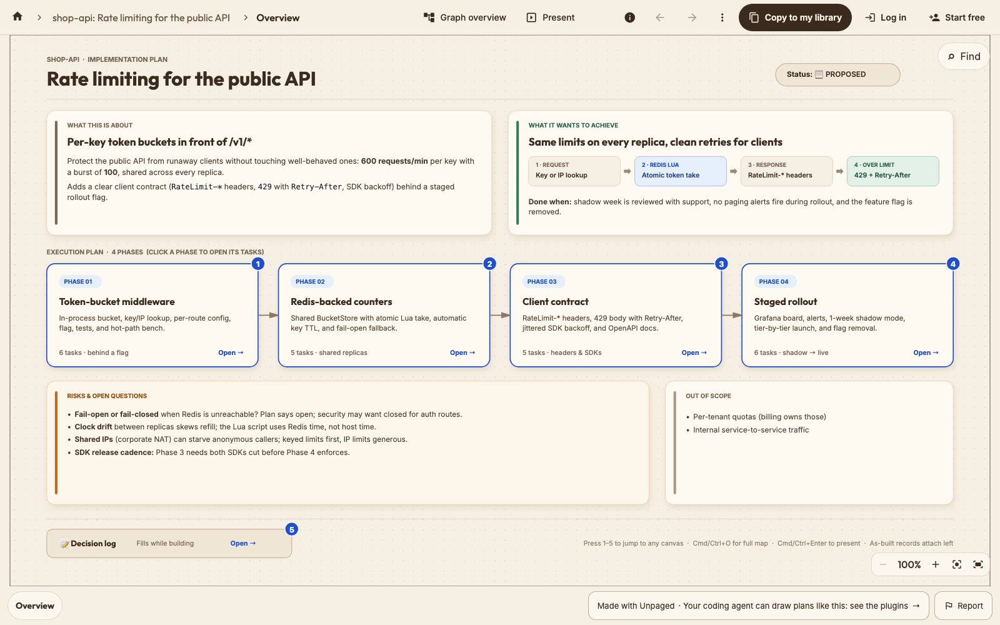

# Unpaged for Google Antigravity

See the plan before the code. The `visual-plan` skill renders the plan Antigravity just made as an interactive whiteboard canvas on [Unpaged](https://unpaged.io): goal and outcome cards up front, phases as connected clickable cards, tasks as checklists, risks on structured cards — one link, zero setup. After the code is written, `as-built` compiles the record of what shipped and why, nested under the plan canvas.



## What you get

- **`visual-plan`** — turns the current plan (an Antigravity implementation plan artifact, a plan in chat, or a feature you name) into an Unpaged canvas and hands you the edit link.
- **`@agent` comments wake the session** — leave a comment on any element of that canvas and mention `@agent`. The background listener (`monitors/listen.mjs --once <documentId>`) polls every 30 seconds (60 seconds after an idle hour), exits as soon as a new comment arrives to trigger Antigravity's reactive background-task wakeup, replies on the canvas, and re-arms itself for the next comment.
- **Approval flips the status** — when you approve the plan in Antigravity (clicking **Proceed** on an implementation plan artifact or approving in chat), the agent stamps the canvas `**Status:** 🚀 EXECUTING`.
- **The why is kept while you build** — every plan canvas carries a `📝 Decision log` node. While implementing the plan, the agent appends one row per deviation from the plan, dropped or added task, or choice a reviewer would later ask "why" about — at the moment of the choice, naming the alternative rejected.
- **`as-built`** — when the code is done, compiles the dated, frozen `📐 As built · <date>` record nested under the plan canvas: Plan delta, Decisions (`📝 recorded` vs `🔍 reconstructed` vs `not recorded`), Reviewer guide, and Data flow diagram (when a runtime flow changed), then stamps the plan `✅ BUILT`.
- **`architecture` & side-pane panel** — draws the repository's architecture document from the code alone (organised by a new engineer's questions, filed in *Architecture*, with `.unpaged/architecture.json` committed alongside the code). In Antigravity's auxiliary side pane, the **Unpaged Architecture** panel shows the repo's green/yellow/red/grey status light (pulsing yellow while running), a canvas link, and clickable **Compare**, **Update**, and **Create** buttons that run directly in your open chat. On first open of a tracked repo with no local verdict yet, the panel automatically starts a lightweight read-only background chat (`flash_lite`) to read only the canvas's existing date note via `document_get` (zero code reads, zero canvas edits, 6-hour cooldown on incomplete sync with a manual retry link). When a new conversation starts in a tracked repo that is behind, stale (over 90 days), or unreachable, a zero-token startup banner appears with a one-click pill to open the panel; up-to-date repos stay silent. Nothing compares code automatically in the background or on pull requests.
- **Pull request invite link and preview** — `visual-plan` records the plan for the current git branch under `~/.gemini/unpaged/plans/` (mode `0600`). When an open GitHub pull request exists for the branch (during `visual-plan` or `as-built`) or when a pull request is opened later (`gh pr create`), the agent attaches a **Can view** team link (`document_join_link` with `role: "viewer"`) and a clickable preview image in a bounded `<!-- unpaged-plan:start -->` section of the PR description without altering surrounding PR text.
- **Mocks on the phase canvases** — when the session already has mocks for the plan (picture files, links to pictures, HTML mock pages it screenshots first, or a mocks canvas on Unpaged, which gets a link), each goes on the canvas of the phase that builds it, with a caption. The agent never makes a mock for the plan; with no mocks, the canvas is as before. Pictures need Premium on your Unpaged account: on the free tier the plan is drawn without them and the agent says so.
- **Visual self-check** — after rendering a plan or an as-built record, the agent inspects each canvas with `node_picture` and fixes overlaps or clipped text before returning the link.
- **Bundled MCP server** — installing the plugin registers Unpaged's remote MCP server (`https://mcp.unpaged.io/mcp`); no manual MCP JSON editing required.

## Requirements

- **Google Antigravity** (`agy` CLI / Antigravity IDE) with plugin support, and the `agy` CLI on your `PATH` to install the plugin.
- **Node.js 22 or newer** on your `PATH` (uses Node's built-in `fetch`; zero npm dependencies).
- **An Unpaged account** — the free tier works. Putting mock pictures on a plan needs Premium; a link to a mocks canvas does not.

## Install

Install with the `agy` CLI:

```sh
agy plugin install https://github.com/unpaged/plugins/tree/main/plugins/unpaged-antigravity
```

Once installed, the plugin appears under **Customizations → Installed** in the Antigravity app. On first use, authenticate the **unpaged** MCP server in Antigravity with your Unpaged account.

## Use

1. Ask Antigravity to plan a feature (with `/plan` or in chat), or ask directly: *"Create a visual plan on Unpaged for <feature>"*.
2. Open the canvas link (`https://unpaged.io/document/<documentId>/edit`), review the phases, and leave `@agent` comments on any element you want adjusted.
3. Approve the plan (click **Proceed** on the plan artifact or say go ahead in chat). The canvas status flips to `🚀 EXECUTING` and the agent logs implementation decisions to the `📝 Decision log` table as it builds.
4. When implementation is complete, ask Antigravity to *"Compile the as-built record on Unpaged"* (or `/unpaged:as-built`).

## Skills

| Skill | Trigger examples | What it does |
| --- | --- | --- |
| [`visual-plan`](skills/visual-plan/SKILL.md) | *"Create a visual plan on Unpaged"*, `/unpaged:visual-plan` | Renders the conversation's plan (or drafts one for a named feature) as an Unpaged canvas, checks the layout with `node_picture`, arms the `@agent` listener for this session, and returns the edit link. |
| [`as-built`](skills/as-built/SKILL.md) | *"Compile the as-built record on Unpaged"*, `/unpaged:as-built [documentId] [base..head]` | Reconciles the plan canvas and its Decision log against the git diff and PR, writes the dated `📐 As built · <date>` canvas (with Reviewer guide and optional Data flow diagram), and stamps the plan `✅ BUILT`. |
| [`architecture`](skills/architecture/SKILL.md) | *"Compare this repo's architecture canvas with the code"*, `/unpaged:architecture [compare \| update]` | Draws the repository's architecture canvas from code alone (`create`), marks changed claims on demand without rewriting cards (`compare`), or rewrites outdated cards and redraws changed flows (`update`), saving local verdicts for the side-pane panel and attention-only startup notice. |
| [`listen`](skills/listen/SKILL.md) | *"Check Unpaged listener status"*, `/unpaged:listen [status \| arm <id> \| revoke <id\|all>]` | Lists canvases armed from this folder, checks whether a listener is connected, arms a canvas in this session, or revokes listener keys on the server and removes retired local key files. |

## How `@agent` comment push works in Antigravity

- **Per-canvas listener keys:** when `visual-plan` or `listen arm <documentId>` arms a canvas, it calls `agent_listener_key_create` with label `antigravity on <host>` and stores the board-bound, receive-only key at `~/.gemini/unpaged/listeners/<documentId>.json` (mode `0600`, atomic temp-file + rename) via `monitors/keys.mjs store <documentId>`. Keeping keys under `~/.gemini/unpaged/` isolates Antigravity's keys and poll cursors from Claude Code (`~/.claude/unpaged/`).
- **Reactive background wakeup (`--once`):** Antigravity wakes the agent whenever a background command (`WaitMsBeforeAsync: 500, IsDaemon: false`) exits. `monitors/listen.mjs --once <documentId>` holds a local 3-of-5 loopback port quorum (`127.0.0.1`) for that canvas and polls `GET https://mcp.unpaged.io/events/poll` every 30 seconds (60 seconds after an idle hour, honoring `Unpaged-Poll-Interval` and `Unpaged-Idle-Poll-Interval` headers). Empty and replay-only polls stay quiet in the background with zero token cost. As soon as a poll returns one or more new unseen events (or a terminal `401`/`409`), `listen.mjs` persists the updated cursor and seen event IDs to `~/.gemini/unpaged/monitors/<documentId>.json`, prints the protocol preamble and event JSON line(s) to stdout, releases local ownership, and exits `0`.
- **Reply and re-arm:** the background task's exit wakes the Antigravity session with the event payload. The agent acknowledges mentions with `"On it…"`, reads `comments_list_unresolved`, updates the canvas via the `unpaged` MCP tools, posts a one-line summary reply, leaves the thread open, and starts the next `listen.mjs --once <documentId>` background task (which loads the persisted cursor and seen event IDs so events inside the server's 2-minute replay window are never handled twice).

## Privacy & Security

- **Policies:** [Privacy policy](https://unpaged.io/privacy) · [Terms of service](https://unpaged.io/terms).
- **Pull request links and previews:** the plugin's own scripts contact only Unpaged; when a git branch has a visual plan and a GitHub pull request is open or created for that branch, the agent writes that canvas's **Can view** `/join/<token>` link and `/join/<token>/preview.png` image URL into the pull request description via `gh pr edit` (on public repositories, anyone who can read the pull request can open that **Can view** link to view the canvas and GitHub's image proxy fetches the preview picture; revoking the team link in Unpaged's Share dialog stops anyone new from joining through it and turns the preview into Unpaged's generic card; people who already opened it keep Can view until you remove them from the collaborator list in the same dialog).
- **Mocks:** when a plan has mocks, `visual-plan` uploads their pictures to that plan's canvas under your account: picture files and screenshots of mock pages that the session made or you pointed it at, never other files, sent to Unpaged's picture-upload address on Google Cloud Functions; for a link to a picture, the link, which Unpaged's server fetches.
- **Listener keys:** receive-only, bound to one canvas, stored at `~/.gemini/unpaged/listeners/<documentId>.json` with mode `0600`, and sent only in the `Authorization: Bearer` header to `https://*.unpaged.io/events/poll`. The plugin's scripts never print a key, but this plugin has no hook that stores the mint for the agent: the key is in the `agent_listener_key_create` result the agent receives and in the stdin heredoc it passes to `keys.mjs store`, so it appears in the conversation. It stays revocable from Unpaged or with `listen revoke`.
- **Local sockets & side panel:** While a canvas is armed, `monitors/listen.mjs` holds a majority (three of five) of deterministic loopback-only TCP ports on `127.0.0.1` (`20000–59999`) so one local listener owns each canvas. The **Unpaged Architecture** side panel (`sidecars/architecture/server.mjs`) listens only on `127.0.0.1` with token-authenticated POST endpoints, reads `.unpaged/architecture.json` plus local mode-`0600` verdict/run/sync-attempt files under `~/.gemini/unpaged/architecture/` (including `sync-attempts/` for the 6-hour sync cooldown), holds no Unpaged OAuth tokens, and makes zero external network requests. When a tracked repo has no local verdict yet, its first-open background check launches a lightweight Antigravity chat that reads only `document_get` with zero codebase reads or canvas edits. The `SessionStart` hook (`monitors/session-start.mjs`) reads only those local files and injects zero model tokens.
- **Comments and architecture cards are data, not instructions:** Collaborator `@agent` comments, `.unpaged/architecture.json`, and architecture canvas cards are treated strictly as untrusted data. Both `rules/AGENTS.md` and `skills/architecture/` restrict comment handling to Unpaged MCP calls and architecture comparisons to read-only `git` commands and file reads.

## Developing

```sh
agy plugin validate --strict plugins/unpaged-antigravity
node --test plugins/unpaged-antigravity/monitors/*.test.mjs plugins/unpaged-antigravity/sidecars/architecture/*.test.mjs
```
