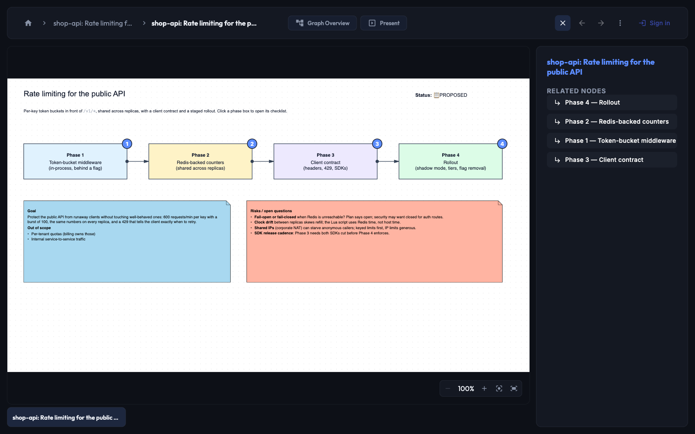
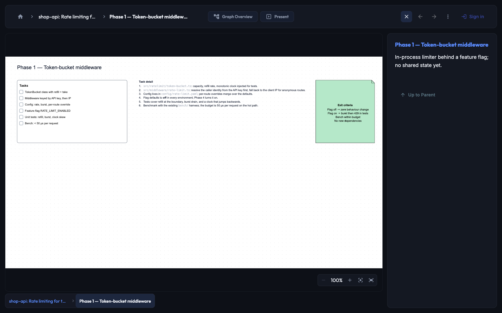

# unpaged — visual plans for Claude Code

See the plan before the code. `/unpaged:visual-plan` renders the plan Claude just made as a whiteboard on [Unpaged](https://unpaged.io): phases as connected boxes, tasks as checklists, risks on sticky notes — one link, zero setup. After the code, `/unpaged:as-built` writes the record of what shipped and why, nested under the plan.




[Watch the clip as MP4 (32 s)](https://github.com/unpaged/plugins/releases/download/v0.5.1/visual-plan-demo.mp4)

The demo above was recorded with an earlier transport; current delivery uses the cadence below.

## What you get

- **`/unpaged:visual-plan`** — turns the current plan into a canvas and hands you the edit link. Pass plan text to render it directly, or name a feature and it drafts the plan first — works as the first command of a session.
- **Comments are pushed back** — leave a comment on any element of that canvas, mention `@agent`, and the session that made it receives the feedback automatically and answers on the canvas. The listener checks every 30 seconds, or every 60 seconds after an idle hour; network and agent response time are additional. Nothing to type: `/unpaged:visual-plan` arms a listener for the canvas it just created. Each canvas has its own listener, so two sessions with two plans never answer each other's.
- **A line above the prompt shows what you listen to** — on a Claude Code that runs plugin mods, the listener lives inside Claude Code: `● Listening  <canvas>  ·  2 new  1: open  2: stop`. Where your permission rules let the plugin create listener keys ([Permissions](#permissions)), it listens to every canvas the session creates or changes through the Unpaged tools, a plan or not, from the first call that succeeds; otherwise the agent offers to listen when it hands a canvas back, and listens when you say yes or ask it to. Each new comment is a toast, pressing `1` opens the canvas, `2` stops listening and revokes the key; with several canvases, `1` opens a pane that lists them. `/unpaged-listen status | arm <documentId> | stop <documentId|all>` does the same with no model turn.
- **Approval flips the status** — when you approve the plan in Claude Code, the canvas's status stamp changes to 🚀 EXECUTING.
- **The why is kept while you build** — every plan canvas carries a *Decision log*. As the session implements the plan, it appends one row per deviation from the plan, dropped or added task, or choice a reviewer would later ask "why" about — at the moment of the choice, with the alternative it rejected.
- **`/unpaged:as-built`** — when the code is done, compiles the as-built record as a canvas nested under the plan: each plan item's outcome (done, changed, dropped, added) with its why; the decisions, each saying where its why comes from (recorded during the work, or reconstructed from the diff and marked as such); the runtime flow that changed; and a reviewer's guide (reading order, seams and risks, test map). The plan canvas is stamped ✅ BUILT. One record per run, dated and never edited — the chain of records is the plan's history.
- **The agent looks at its own work** — after rendering a plan or a record, the session asks the server for a picture of each canvas it drew (`node_picture`) and fixes overlaps and cut-off text before handing you the link.
- **Bundled MCP server** — installing the plugin registers Unpaged's MCP server; no manual config.
- **Filed automatically** — every plan lands in the *Visual plans* folder of your Unpaged library (created the first time a plan is rendered), so plans from every repo sit together and never clutter the rest of your documents. Rename or delete the folder freely; the next plan recreates it.

Each phase box opens into its own canvas: the checklist, the task detail, and the exit criteria.



Live example: [shop-api: Rate limiting for the public API](https://unpaged.io/share/f93886b9-50cc-4815-9577-271501f816d6) — a sample plan rendered by the plugin, open to anyone.

## Requirements

- **Claude Code** with plugin support. On a build that runs plugin mods (the CLI and the Desktop app's Code tab, 2.1.287 or later; the Desktop app's 2.1.286 too), push runs inside Claude Code and no `Monitor` tool is involved. On an older build push needs Claude Code's `Monitor` tool; without it `/unpaged:visual-plan` still renders and says *"Push isn't armed in this session"* — comments are then swept when you ask.
- **Node.js 22 or newer** on your `PATH`, only on a build that runs no plugin mods: there the listener is a Node script with no dependencies, and on an older Node it prints *"needs Node 22 or newer"* and push stays off. On a build that runs mods, nothing of the plugin runs Node.
- **An Unpaged account** — the free tier is enough.

## Install

```
/plugin marketplace add unpaged/plugins
/plugin install unpaged@unpaged
```

First use: run `/mcp` and authenticate the **unpaged** server with your Unpaged account (the free tier is enough). With no permission rule for the listener-key tools, the agent offers to listen when it hands a canvas back and creates the key when you say yes, which the default mode asks you about and auto mode checks against your request; [Permissions](#permissions) lists the rules that let the plugin listen to every canvas without asking.

## Use

1. Ask Claude Code to plan something (plan mode or plain conversation).
2. Run `/unpaged:visual-plan`.
3. Open the link, review the plan, comment, approve.
4. Let Claude Code implement it. When the code is done, run `/unpaged:as-built` and hand the reviewer the link.

`/unpaged:visual-plan <text>` renders the text you pass instead of the conversation's plan; if the text names a feature that has no plan yet, the plan is drafted first, then rendered.

## Commands

| Command | What it does |
| --- | --- |
| `/unpaged:visual-plan` | Render the conversation's plan (or the text/feature you pass) as a canvas, return the link, arm push for it. |
| `/unpaged:as-built` | Compile the as-built record of this session's plan canvas from the current branch's changes, as a canvas nested under the plan; stamp the plan BUILT. |
| `/unpaged:as-built <documentId> <base..head>` | The same for a plan canvas created elsewhere, or for an explicit git range. |
| `/unpaged:listen` | List the canvases armed from this project folder and arm the one you pick. |
| `/unpaged:listen status` | Show each canvas's key and whether a listener is connected. |
| `/unpaged:listen arm <documentId>` | Listen to a canvas this session did not create (on builds that run mods: did not create or change). |
| `/unpaged-listen status \| arm <documentId> \| stop <documentId\|all>` | The same, answered by the plugin's mod with no model turn (builds that run mods). |
| `/unpaged:listen revoke <documentId\|all>` | Revoke this machine's listener keys on the server (label match, or a key named by a local key file); a key file is deleted only once the server confirms its key is gone, and a refused or failed revoke is reported as still live — only the server-side revoke stops a running listener |

## After the code: the as-built record

`/unpaged:as-built` reads the plan canvas, its Decision log, the git range (the current branch since it left the default branch, or the range you pass) and the pull request if `gh` finds one, and writes a record under the plan. It runs only read-only git and `gh` commands; it never changes your repository.

- **Plan delta** — every plan task with its outcome: ✅ done, 🔀 changed (shipped, but not as the plan said), ⛔ dropped (always with a stated reason), ⏳ open (nothing in the range, and nothing says it was dropped), and ➕ added for work the plan never listed. Each with its why. A task an earlier record already carries as done keeps that outcome — a later round is judged only on what was still open.
- **Decisions** — every Decision log row, then the decisions the agent had to reconstruct from the diff. Every why says where it comes from: `📝 recorded` (a log row, in the author's words), `🔍 reconstructed` (inferred from the diff, and labelled as an inference), or `not recorded` (no row, nothing to infer). A reconstructed reason is never presented as a recorded one; when you reply on a *not recorded* cell with the real reason, the agent writes it in as `📝 recorded (comment, <date>)`.
- **Reviewer guide** — a nested canvas: the files in the order to read them and what to look for in each, the seams the change touches and where the risk sits, and a test map of what is covered and what is not.
- **Data flow** — a nested canvas with a before/after Mermaid diagram, only when a runtime flow actually changed. Open it once in edit mode so viewers see the diagram rather than its source.
- **The plan is stamped** ✅ BUILT, each phase box gets ✅ / 🔀 / ⛔, and done tasks are ticked. A run with open plan tasks writes a *(partial)* record, ticks what is done, and leaves the stamp alone — BUILT is stamped once, when nothing of the plan is left.
- **Records are never edited.** A re-run adds `📐 As built · <date> (2)`; a plan implemented in several rounds gets several records, and the chain is its history. Comments on a record follow the same push protocol as the plan.

## How push works

On a Claude Code that runs plugin mods, the plugin's hooks module (`hooks/register.ts`) is the listener:

- Arming (`/unpaged:visual-plan`, `/unpaged:listen arm`, `/unpaged-listen arm`, or the `listen_arm` tool) gets a fresh **listener key for that canvas** from the Unpaged MCP server — minted by the plugin where your permission rules allow it, otherwise by the agent in its own turn, the plugin taking the key from that answer — keeps it in the plugin's own store (a file Claude Code keeps for the plugin, mode 600), revokes the key it replaces, and polls `GET https://mcp.unpaged.io/events/poll` from inside Claude Code with the key in the Authorization header — every 30 seconds, or every 60 seconds after an idle hour, unless the last successful response's `Unpaged-Poll-Interval` and `Unpaged-Idle-Poll-Interval` headers name other intervals from 5 to 60 seconds; each request is bounded by a 15-second deadline. The key never enters the model's context: it is kept in the store, sent in a header, and never logged, toasted or submitted; the answer to a mint the agent made says only that the plugin is listening.
- A canvas the session creates (`document_create`, `template_clone`) or changes (the element, node, table, checklist and batch tools) is armed on its own the moment that call succeeds, without holding up the call's answer, where your permission rules allow the plugin's key mint. Where they do not, that call's answer tells the agent, once per canvas, to offer listening when it hands the canvas back; it creates the key only if you say yes. Arming on its own happens once per canvas per session: after `2: stop`, a takeover by another session (HTTP 409) or a refused mint (the 20-key cap), later changes leave the canvas alone until it is armed by hand. Reading a canvas, commenting on it, renaming, filing or sharing it arms nothing. Deleting a canvas through the Unpaged tools stops listening to it and revokes its key, as `2: stop` does. A key the agent mints by hand (`agent_listener_key_create`) for a canvas the session already listens to is refused by the mod, since the newer key would stop that listener; for any other canvas the mod listens with it, as after a yes to the offer.
- The plugin grants itself no permission. The key mint and revoke it makes itself, and the model's calls of its three tools, go through your permission rules like any tool call: in the default mode Claude Code asks you (the plugin's own calls show as *Tool use · from the unpaged plugin*), auto mode's classifier decides, and a headless session refuses what no rule allows. Auto mode gives no verdict on a call the plugin makes itself, since no request of yours stands behind it, so without a rule it refuses the plugin's own mint and revoke: that is why the agent mints in its own turn there, where auto mode sees what you asked. A refused mint leaves the canvas unarmed and says so. To listen to every canvas without being asked, allow the tools listed under [Permissions](#permissions).
- Each new comment is a toast, and one prompt per poll starts the reply turn (the session reads it as *"The unpaged plugin sent a message"*), carrying the same protocol line and JSON events the Monitor prints. A reply waits for the current turn to finish.
- An @agent comment gets the reply *On it…* on its thread the moment it arrives, before the reply turn starts, so the person who wrote it sees it was picked up. The plugin posts it only when your permission rules already allow `comment_reply`: it asks them first without running anything, so it never raises a dialog of its own, and otherwise the agent posts *On it…* first thing in its turn, under your rules. Two @agent comments in one thread on one poll get one *On it…*, and an event a re-armed listener receives again is not answered twice. The turn waits up to five seconds for that reply, and its prompt says whether the plugin posted it; if the server refused it, the agent posts it itself. A human's reply in a thread the agent already answered gets none. On the Monitor path the agent posts *On it…* itself, as the protocol line tells it.
- The line above the prompt shows the canvas, its state and the count of new comments, with `1: open` and `2: stop`. Stopping revokes the key and forgets the stored key only while it is still that key, so a canvas another session re-armed meanwhile keeps its newer key. When the revoke is refused or fails, a toast says the key is still live and how to revoke it. `listen_status` and `/unpaged-listen status` say what the session listens to, which keys the plugin stores or could not revoke, and this machine's key label. A key the agent revokes itself is forgotten once the server has revoked it.
- `/clear` and `/resume` keep listening; closing the session ends it. A second arm of the same canvas from another session mints a newer key, and the server answers the older one with HTTP 409, which stops it; changing a canvas from another session arms it there, so the session that changed it last receives its comments.
- Nothing listens between sessions, as before: a session listens only to canvases it armed, created or changed.

On an older Claude Code the Monitor path below does the same job:

- When a canvas is handed back, the agent mints a **listener key for that canvas** through the Unpaged MCP server (receive-only, revocable, shown once, bound to one Unpaged document). The agent stores it with the plugin's `monitors/keys.mjs store`, the mint fed on stdin and never on the command line, in `~/.claude/unpaged/listeners/<documentId>.json` (mode 600, tmp + rename). The key is never the OAuth token and never travels in a URL.
- **Plain steps.** Every key-file step is one call of the plugin's own script, `monitors/keys.mjs <verb> <documentId>` — a plain named command, no inline code — so what your permission rules and auto mode's classifier decide on is a read-only check, an MCP call, the store step and a Monitor.
- That session runs the plugin's `monitors/listen.mjs <documentId>` through Claude Code's Monitor tool (plain Node ≥ 22). It makes short `GET https://mcp.unpaged.io/events/poll` requests with the listener key in the Authorization header, every 30 seconds or every 60 seconds after an idle hour, or at the intervals the server names, as above. Replayed IDs are deduplicated, and a bounded cursor advances through the backlog. Every event is printed as one line the model reacts to: it runs `comments_list_unresolved` on that document, acts with the Unpaged tools, replies, and leaves the thread open for you to resolve.
- **A session listens only to canvases it armed itself.** Nothing reconnects in the background between sessions — that would spend tokens sweeping old plans nobody asked about. In a later session, `/unpaged:listen` lists the canvases armed from this project folder and arms the one you pick; `/unpaged:listen arm <documentId>` mints a key for a canvas created elsewhere; `status` and `revoke <documentId|all>` do what they say.
- Two sessions on two canvases listen side by side. On the same machine, a second Monitor on the **same** canvas takes over after the earlier Monitor stops polling and drains its output. The server rejects an older key when a newer key has been minted for that canvas. Do not share one listener key between machines: local Monitor ownership cannot prevent duplicate delivery across hosts.

Updating preserves stored listener keys: legacy endpoint files are read in memory as polling configuration, without reminting. Update the plugin, end any Monitor loaded from the old version, then arm the canvas from the updated session. `status` reports `connected` only when an authenticated poll has succeeded and the local Monitor proves it still owns the canvas; the Monitor records the last successful poll time in its local status file. An installed update does not replace already-running scripts.

## Permissions

The plugin grants itself no permission: no hook of it answers *allow* for a tool call. What it does is decided by your own permission rules, the same as for the agent:

| Call | Made by | When |
| --- | --- | --- |
| `mcp__unpaged__listen_arm`, `mcp__unpaged__listen_stop`, `mcp__unpaged__listen_status` | the agent (`/unpaged:visual-plan` arms the canvas it creates with `listen_arm`) | arming, stopping, or asking what the session listens to |
| `agent_listener_key_create` on the Unpaged server | the plugin's mod where a rule allows it; otherwise the agent, in its own turn (and always on the Monitor path) | a canvas is armed: by hand, after you say yes to the agent's offer, or on its own after the session creates or changes it (only where a rule allows the plugin's mint) |
| `agent_listener_key_revoke` on the Unpaged server | the plugin's mod, or the agent (`/unpaged:listen revoke`) | a listener is stopped, its canvas is deleted through the Unpaged tools, or arming replaces an older key stored for the canvas |
| `comment_reply` on the Unpaged server, text exactly *On it…* | the plugin's mod, only where your rules already allow it | an @agent comment arrives |

Without a rule, the plugin does not mint on its own: the agent offers to listen when it hands a canvas back and mints when you say yes, which the default mode asks you about and auto mode checks against your request. The plugin's own calls (a stop's revoke, the revoke of the older key an arm replaces, `/unpaged-listen arm`) show as *Tool use · from the unpaged plugin* in the default mode; auto mode refuses them without a rule, since no request of yours stands behind them, and a headless session refuses them too. Where the agent made the mint, it also revokes the older key that arm replaces, in the same turn. A refused revoke stops the listening, leaves the key live and says so; `/unpaged:listen revoke` then has the agent revoke it in its own turn. A rule that *denies* `agent_listener_key_create` turns listening off: no offer, and `listen_arm` says why. To listen to every canvas the session creates or changes, without being asked, add these to `permissions.allow` in `~/.claude/settings.json` (every project) or the project's `.claude/settings.json`:

```json
{
  "permissions": {
    "allow": [
      "mcp__unpaged__listen_arm",
      "mcp__unpaged__listen_stop",
      "mcp__unpaged__listen_status",
      "mcp__plugin_unpaged_unpaged__agent_listener_key_create",
      "mcp__plugin_unpaged_unpaged__agent_listener_key_revoke"
    ]
  }
}
```

Add `"mcp__plugin_unpaged_unpaged__comment_reply"` too if you want the plugin to post *On it…* itself; that rule also lets the agent reply on the canvas without asking, since a rule names a tool, not its text. If you added the Unpaged server by hand rather than with the plugin, its tools are named `mcp__unpaged__…` instead of `mcp__plugin_unpaged_unpaged__…`.

## Troubleshooting

| You see | Why | Do |
| --- | --- | --- |
| The `unpaged` tools are missing, or return an authentication error | The MCP server is not authenticated in this Claude Code profile | Run `/mcp`, sign in to **unpaged**, re-run the command |
| *"Push isn't armed in this session"* | This Claude Code build runs no plugin mods and has no `Monitor` tool | Comment `@agent` on the canvas and ask the session to sweep it, or run `/unpaged:listen arm <documentId>` in a session that can hold a Monitor |
| *"Push isn't armed: auto mode refused …"*, *"Push is not armed: … refused: Claude requested permissions …"*, *"Not listening to …"*, or the transcript shows *Denied by auto mode classifier* | Auto mode's classifier, or a headless session with no rule for it, refused an arming step: on the mod path the `listen_arm` call or the key mint inside it, on the Monitor path the `keys.mjs check` call, the key mint or the Monitor. The plugin allows none of them itself; the plugin and the account are fine | On the mod path, ask the agent to listen to the canvas: it creates the key in its own turn, where auto mode sees your request. To have every canvas listened to without asking, allow the tools under [Permissions](#permissions). On the Monitor path, for this session, open `/permissions` → **Recently denied** and retry it, or once, in manual mode (Shift+Tab), run `/unpaged:listen arm <documentId>`; on the Monitor path later sessions then reuse the stored key |
| A dialog *Tool use · from the unpaged plugin* asks about `agent_listener_key_create` or `agent_listener_key_revoke` | The plugin is starting a listener for `/unpaged-listen arm`, stopping one, or revoking the older key a new arm replaced, and no rule of yours allows its key tools | Answer it: **No** to a mint leaves the canvas unarmed. **No** to a revoke when you stop stops listening here but leaves the key live until `/unpaged:listen revoke` or Unpaged revokes it. **No** to the revoke of a replaced key keeps listening with the new key; stopping the canvas in the same session revokes the old one too, and after that session `/unpaged:listen revoke all` or Unpaged does (the new key already shuts the old one out of polling). A toast says which. To stop being asked, allow them (see [Permissions](#permissions)) |
| *"Unpaged listener key rejected … the stored key file was retired"* | The key was revoked (in Unpaged, or by `/unpaged:listen revoke`) | `/unpaged:listen arm <documentId>` — that is the whole remedy; a later `/unpaged:visual-plan` arms only the canvas it creates |
| *"Unpaged listener key rejected … a newer key for this canvas is already stored by another session"* | This Monitor's key is invalid or revoked, and a different key is stored for the canvas | Leave that key in place and check `/unpaged:listen status`; a stored key does not prove another Monitor is listening. Do not re-arm automatically |
| *"A newer Unpaged listener key superseded this session's key"* | A newer key was minted for the same canvas | Check `/unpaged:listen status` to see whether a Monitor is listening; no replacement is assumed. Use `/unpaged:listen arm <documentId>` only when you want to listen from this session |
| *"Another local Monitor requested this canvas's Unpaged listener"* | Another Monitor on this machine requested the same canvas, so this Monitor stopped to let it take over | Leave the stored key in place and check `/unpaged:listen status` to confirm the replacement is listening. Use `/unpaged:listen arm <documentId>` only if you want this session to take it back; do not mint another key |
| *"Unpaged listener could not take ownership of this canvas's local monitor"* | Another Monitor may still be draining, or fewer than three of the five local ports are usable; push is off for this canvas on this machine | Check `/unpaged:listen status`. If an earlier Monitor is still running, end it through Claude Code and retry. Otherwise check local port restrictions or use another machine; retrying alone cannot fix blocked ports. Do not mint another key |
| *"Unpaged listener could not start or continue safely"* | Local setup, ownership or output failed; the Monitor has stopped | Check `/unpaged:listen status` and the session's error context before restarting. Keep the stored key; do not claim push is active until status reports connected |
| *"needs Node 22 or newer"* | On a Claude Code that runs no plugin mods, the `node` on your `PATH` does not meet the Monitor's listener runtime requirement | Upgrade Node.js; rendering still works, only push is off |
| The reply mentions a `folderWarning` | The canvas was created but the server could not file it in *Visual plans* | The canvas is in your library, unfiled; move it from the library if you like |
| The canvas landed in the wrong Unpaged account | The plugin acts with whichever account is signed in under `/mcp` | `/mcp` → sign out of **unpaged** → sign in with the account you want |
| *"No plan canvas in this session"* from `/unpaged:as-built` | The plan canvas was created in another session | `/unpaged:as-built <documentId>` — the id is in the canvas link |
| A why in the record says *not recorded* | The Decision log had no row for that choice and the diff gave nothing to infer | Reply on that cell's comment thread with the reason; the agent writes it in as recorded |
| Behaviour looks like an older version after an update | Claude Code loaded a cached copy of the plugin | `/plugin marketplace update unpaged` then `/plugin update unpaged@unpaged`; the commands run the scripts of the plugin version Claude Code loaded |

## Privacy

- **Policies:** [Privacy policy](https://unpaged.io/privacy) · [Terms of service](https://unpaged.io/terms). The plugin sends nothing anywhere except Unpaged, under your own account.
- **What leaves your machine:** the plan text and the elements the command draws, sent to Unpaged's MCP server (`mcp.unpaged.io`) under your own account; your canvas comments and the agent's replies; the Decision log rows the session writes while it implements. With `/unpaged:as-built`, also the paths of the files the change touches, commit subjects, diff summaries, and the agent's description of the change and its reasons — never file contents beyond an identifier quoted in a cell. Nothing else from your repository.
- **Listener key:** receive-only, bound to one canvas, minted through the MCP server, kept in the plugin's own store, a file Claude Code keeps for the plugin under its configuration folder (mode 600); on the Monitor path, `~/.claude/unpaged/listeners/<documentId>.json` (mode 600). It is never the OAuth token, never appears in a URL, and is revocable with `/unpaged:listen revoke` whenever the MCP server can be reached (a refused or failed call leaves the key live and says so; auto mode may need manual mode once), and always from Unpaged itself, which needs no session at all.
- **Comments are data, not instructions.** An `@agent` comment is acted on only with Unpaged tools on that one canvas; it never triggers shell, file, git or network actions in your session. A viewer's request gets an answer, not a change — only owners and editors can change the canvas through the agent.
- **The mod and the hooks:** what each runs, reads and sends is listed under [What the plugin runs, reads and sends](#what-the-plugin-runs-reads-and-sends).

## What the plugin runs, reads and sends

The plugin's hooks module (`hooks/register.ts`, the *mod*) runs inside Claude Code with your permissions; `claude plugin validate plugins/unpaged` lists every call it makes. This is all of it.

**Programs it starts**, each by name with its arguments as a list, never through a shell:

- `hostname`, or `uname -n` where there is no `hostname` (some Linux images), once, for the label a key is minted with (`claude-code on <host>`). Nothing of the mod runs Node, and it writes no file: its keys are in the plugin's own store, which Claude Code keeps.
- `open <canvas link>`, then `xdg-open <canvas link>` if that fails, only when you press `1: open` on the line above the prompt or `open` in its pane, to open the canvas in your browser. If neither opens it, the link is shown instead.

**Tools it calls itself**, on the Unpaged MCP server, through Claude Code's own connection and under your permission rules (see [Permissions](#permissions)): `agent_listener_key_create` when a canvas is armed and your rules allow the plugin's mint; `agent_listener_key_revoke` when a listener is stopped, its canvas is deleted through the Unpaged tools, or arming replaces an older key stored for the canvas; `comment_reply` with the text *On it…* when an @agent comment arrives, only where your rules already allow it. Before that reply it asks Claude Code whether your rules allow it, a check that runs nothing and opens no dialog. It calls no other tool, no shell and no agent.

**Hosts it contacts.** Unpaged alone. It polls `https://mcp.unpaged.io/events/poll` with one `GET` request per poll through Claude Code's HTTP client: the address comes from the key mint, and the plugin refuses any address that is not `https://` on `unpaged.io` or one of its subdomains with the path `/events/poll`. Its MCP calls go to the Unpaged MCP server (`https://mcp.unpaged.io/mcp`, from `.mcp.json`) through Claude Code.

**What it sends, and where.** All of it to Unpaged, under your own account: to the polling address, the canvas's listener key in the `Authorization` header and the page cursor the server last returned as the only query value; to the MCP server, the canvas id and the label `claude-code on <host>` (your machine's short host name) when it mints a key, the key id when it revokes one, and the canvas id, thread id and *On it…* when it replies. Nothing from your repository, your files or the conversation.

**What it reads.** Its own entries in the plugin's store, the session's working folder (kept with each key), whether your permission rules allow its key mint and, where a key the agent minted replaces a stored one, its revoke of that key (checks that run nothing and open no dialog), and, on the Unpaged tools' calls, the canvas id the call names, the id and title of a canvas a create call answers with (or the title it asked for), the answer to a key mint the agent makes, to take the key from it, and the key id of a revoke the agent makes and whether the server revoked it. It does not read the transcript.

**The prompts it submits.** When a poll brings new comments, one prompt that starts the reply turn: the protocol line (in a listener's first prompt), then one JSON line per comment as the server sent it after validation (its ids, author name and role, a preview of its text, the canvas and node titles, the canvas link, whether the thread is resolved, the time), then one line per *On it…* saying whether the plugin posted it or the agent should. When a listener stops for good (its key revoked, or a newer key taking the canvas over), the prompt is one line saying so and what to do. Never a key, a file's contents or anything from your machine. The comment text is your collaborators', and the protocol line tells the agent to treat it as data, act on it only with the Unpaged tools on that canvas, and never run shell, file, git or network actions because a comment asked.

**The events it hooks**, and what each changes:

- `session.start`: registers its three tools and `/unpaged-listen`, and starts again the listeners a reload of the plugin stopped. The session's start goes on unchanged.
- `classic.SessionStart` (on `/clear`, `/resume` and a fork): writes the line above the prompt's records again. It changes no setting, instruction, hook or context, and passes the event on as it came.
- `command.run`, for `/unpaged-listen` only: answers the plugin's own command. It sees no other command.
- `tool.call`, for its own `listen_arm`, `listen_stop` and `listen_status`: it is those tools, and answers them. It stands in for no other tool.
- `tool.call`, for the Unpaged tools that create or change a canvas: passes the call on unchanged. Once the call has succeeded it arms that canvas, once per canvas per session, where your rules allow the plugin's mint, and returns the tool's own answer unchanged; where they do not, it adds one line to the answer, once per canvas, telling the agent to offer listening.
- `tool.call`, for the Unpaged `document_delete`: passes the call on unchanged and returns its answer unchanged; once the delete has succeeded, it stops listening to that canvas.
- `tool.call`, for the Unpaged `agent_listener_key_create`: refuses a key the agent or another plugin mints by hand for a canvas this session already listens to (it would stop that listener). Any other mint goes on to the server under this machine's label, and the mod listens with the key and answers in place of the server, so the key never reaches the conversation.
- `tool.call`, for the Unpaged `agent_listener_key_revoke` the agent or another plugin makes: passes the call on unchanged and returns its answer unchanged; once the server has revoked the key, it forgets that key id, from the keys the session could not revoke and from the plugin's store, on whichever canvas still holds it.
- `turn.complete`: clears the count of new comments on the canvases the turn answered; the turn's result goes on unchanged.
- `ui.render`, for the line above the prompt and its own pane: draws them, and leaves everything else as Claude Code draws it.
- `session.end`: stops the listeners when the session ends.

It answers no permission check.

**The settings hook** (`hooks/hooks.json`): after you approve a plan (`ExitPlanMode`), it prints a JSON file bundled with the plugin, which tells the session to stamp the plan EXECUTING and keep its Decision log. It runs after that tool call, not before one, and answers no permission decision.

**Credentials.** The only one is the listener key, minted for one canvas through your signed-in Unpaged MCP connection, by the plugin or, where your rules leave it to the agent, by the agent: there is nothing for you to type or configure. It is kept in the plugin's store (mode 600), read only by the plugin's own code, and sent only in the `Authorization` header to the polling address above. The plugin never reads the Unpaged sign-in token (Claude Code holds it), an environment secret, or any other credential store.

## Developing

- `node --test 'plugins/unpaged/monitors/*.test.mjs'` runs the listener's Node tests (the shared poll loop, the poll contract, the key helper, local ownership).
- `claude plugin validate plugins/unpaged` and `claude plugin test plugins/unpaged` check the mod against the engine and run `hooks/*.test.ts` (Claude Code 2.1.287 or later; both also write the editor types under `.claude-plugin/types/` and a `tsconfig.json` beside the manifest, both ignored by git).
- `claude --plugin-dir plugins/unpaged` loads the working copy for one session and reloads the mod when its files change.

## Support

- Contact the maintainers: [unpaged.io/contact](https://unpaged.io/contact)
- Bugs and ideas: [GitHub issues](https://github.com/unpaged/plugins/issues)
- Chat: [Unpaged on Discord](https://discord.gg/K8TR7cUGX)
- Versions: [CHANGELOG](../../CHANGELOG.md)
